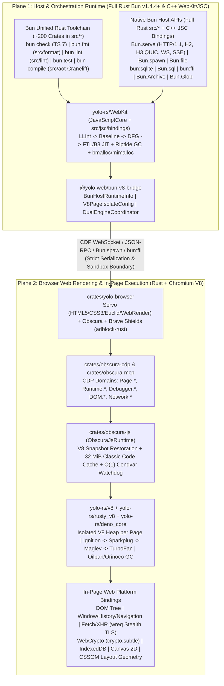

# Bun (WebKit/JSC) + Chromium V8 Dual-Runtime Architecture (`crates/BUN_WEBKIT_V8_ARCHITECTURE.md`)

This specification defines the **Dual-Runtime JavaScript & Web Engine Architecture** of the `yolo-web` monorepo (`https://github.com/yolo-rs/yolo-web`), establishing a strict, zero-leak boundary between two 100% Rust-centric execution planes:

1. **Plane 1 — Host, Tooling, Servers, Bundler, AoT & Agent Orchestration (`100% Native Bun` — `yolo-rs/bun` + `yolo-rs/WebKit`)**:
   Powered by **Upstream Bun v1.4.4+ (Full Rust ~200 crates in `src/*` + C++ WebKit/JavaScriptCore bindings in `src/jsc/bindings/`)** with **Riptide GC**, B3/FTL JIT, and **Cranelift Ahead-of-Time (AoT)** native compilation (`src/aot`). Zero Node.js, zero npm, zero external webpack/esbuild/vitest wrappers.
2. **Plane 2 — Browser Web Rendering & In-Page Guest JS Execution (`100% Chromium V8` — `yolo-rs/v8` + `yolo-rs/rusty_v8` + `yolo-rs/deno_core`)**:
   Powered by **Chromium V8** inside the Rust browser engine (`crates/obscura-js`, `crates/obscura-browser`, `crates/obscura-cdp`, `crates/yolo-browser`). Every browser tab/session runs inside an isolated V8 `Isolate` so web pages, SPAs, React/Next.js/Vue/Svelte hydration, WebCrypto, IndexedDB, `Error.captureStackTrace`, V8 bytecode caches, V8 heap snapshots, `--v8-flags`, and Chrome DevTools Protocol (`Runtime.*`, `Debugger.*`, `Page.*`, `Profiler.*`) behave **identically to Chromium**.

---

## 1. Architecture Diagram

---

## 2. Upstream & Forked Repository Catalog (`yolo-rs/*`)

All core runtime, JavaScript engine, and native Rust/C/C++ dependency repositories are forked and maintained under the [`yolo-rs`](https://github.com/orgs/yolo-rs/repositories) organization:

### 2.1 Core JavaScript Engines & Runtimes

| Forked Repository (`yolo-rs/*`)                             | Upstream Source           | Engine Plane          | Language / Stack                  | Role in `yolo-web`                                                                                                                                                                                |
| :---------------------------------------------------------- | :------------------------ | :-------------------- | :-------------------------------- | :------------------------------------------------------------------------------------------------------------------------------------------------------------------------------------------------ |
| [`yolo-rs/bun`](https://github.com/yolo-rs/bun)             | `oven-sh/bun` (~96.5k ⭐) | **Plane 1 (Host)**    | Full Rust (~200 crates) + C++ JSC | Host JavaScript/TypeScript runtime, package manager (`src/install`), bundler (`src/bundler`), test runner, linter (`src/lint`), formatter (`src/format`), and Cranelift AoT compiler (`src/aot`). |
| [`yolo-rs/WebKit`](https://github.com/yolo-rs/WebKit)       | `oven-sh/WebKit`          | **Plane 1 (Host)**    | C++20 / ASM                       | Bun's patched Apple WebKit / JavaScriptCore (`WTF`, `bmalloc`, `JavaScriptCore`, Riptide GC, B3/FTL JIT, SIMD, AoT runtime facts).                                                                |
| [`yolo-rs/v8`](https://github.com/yolo-rs/v8)               | `v8/v8` (~25.3k ⭐)       | **Plane 2 (Browser)** | C++20 / Torque / CSA              | Official Chromium V8 JavaScript & WebAssembly engine powering in-page browser execution (`Ignition`, `Sparkplug`, `Maglev`, `TurboFan`).                                                          |
| [`yolo-rs/rusty_v8`](https://github.com/yolo-rs/rusty_v8)   | `denoland/rusty_v8`       | **Plane 2 (Browser)** | Rust + C++ V8 FFI                 | Zero-overhead safe Rust bindings to Chromium V8 (`v8::Isolate`, `v8::Context`, `v8::ScriptCompiler`, `v8::IsolateHandle`).                                                                        |
| [`yolo-rs/deno_core`](https://github.com/yolo-rs/deno_core) | `denoland/deno_core`      | **Plane 2 (Browser)** | Rust                              | V8 isolate lifecycle, `#[op2]` fast V8 C-call bindings, module loader, and snapshot generator used by `crates/obscura-js`.                                                                        |

### 2.2 Native `oven-sh/*` Dependencies & Direct Ninja Build Graph (`scripts/build/deps/*`)

Upstream Bun (`yolo-rs/bun` v1.4.4+) is a ~200-crate Rust workspace (`src/*`: `bun_core`, `bun_sys`, `bun_paths`, `bun_alloc`, `jsc`, `aot`, `bundler`, `format`, `lint`, `http`, `sql`, `valkey`, `s3_signing`, `uws`, `css`, `md`, `tar`, `glob`, `spawn`, etc.) paired with C++ JSC bindings (`src/jsc/bindings/`) and first-class Ninja C/C++/Rust dependency edges (`scripts/build/deps/index.ts`):

| Forked Repository (`yolo-rs/*`)                                       | Upstream Source             | Pinned Commit (`oven-sh/bun`) | Role in Host Runtime (`yolo-rs/bun`)                                                                                       |
| :-------------------------------------------------------------------- | :-------------------------- | :---------------------------- | :------------------------------------------------------------------------------------------------------------------------- |
| [`yolo-rs/mimalloc`](https://github.com/yolo-rs/mimalloc)             | `oven-sh/mimalloc`          | `5945551d9ea1e3c8`            | High-performance general-purpose allocator backing `bun_alloc` and WebKit `bmalloc` fallback (`src/mimalloc_sys`).         |
| [`yolo-rs/boringssl`](https://github.com/yolo-rs/boringssl)           | `oven-sh/boringssl`         | `89a2ff2be7752672`            | Google BoringSSL + patches for TLS 1.3, X.509, HTTP/3 QUIC crypto, and `Bun.CryptoHasher` (`src/boringssl_sys`).           |
| [`yolo-rs/lol-html`](https://github.com/yolo-rs/lol-html)             | `oven-sh/lol-html`          | `725ce499aa9b71e3`            | Pure Rust streaming HTML parser/rewriter with CSS selector API powering `HTMLRewriter` in Bun.                             |
| [`yolo-rs/picohttpparser`](https://github.com/yolo-rs/picohttpparser) | `oven-sh/picohttpparser`    | `f4d94b48b31e0aba`            | SIMD-accelerated zero-copy HTTP/1.1 header and chunked-encoding parser (`src/picohttp`).                                   |
| [`yolo-rs/tinycc`](https://github.com/yolo-rs/tinycc)                 | `oven-sh/tinycc`            | `05f0fafaa3be31e3`            | Tiny C Compiler (`tcc`) powering `bun:ffi` `cc()` in-memory native C compilation (`src/tcc_sys`).                          |
| [`yolo-rs/libuv`](https://github.com/yolo-rs/libuv)                   | `oven-sh/libuv`             | `8023581113b276e7`            | Windows asynchronous I/O loop integration tuned with `mimalloc` allocator hooks (`src/libuv_sys`).                         |
| [`yolo-rs/icu`](https://github.com/yolo-rs/icu)                       | `oven-sh/icu`               | Zstd-compressed ICU           | International Components for Unicode linked into `yolo-rs/WebKit` (`Intl.*`, Unicode regex, `String.prototype.normalize`). |
| [`yolo-rs/ninja`](https://github.com/yolo-rs/ninja)                   | `oven-sh/ninja`             | Bun Ninja fork                | Patched Ninja build tool orchestrating unified Rust (`cargo`), C, C++, and NASM build edges (`bun bd`).                    |
| [`yolo-rs/hawk`](https://github.com/yolo-rs/hawk)                     | `oven-sh/hawk`              | `main`                        | Workspace-aware Cargo linter eliminating unnecessary `pub` APIs across Bun's ~200 Rust crates (`hawk.toml`).               |
| [`yolo-rs/rust`](https://github.com/yolo-rs/rust)                     | `oven-sh/rust`              | Tuned Rust toolchain          | Rust compiler toolchain tuned for compiling Bun's ~200 crates and LTO static linking with WebKit.                          |
| [`yolo-rs/wasmtime`](https://github.com/yolo-rs/wasmtime)             | `bytecodealliance/wasmtime` | Cranelift backend             | Cranelift code generator & SSA IR compiler backend powering `bun compile` (`src/aot`).                                     |
| [`yolo-rs/uSockets`](https://github.com/yolo-rs/uSockets)             | `uNetworking/uSockets`      | Bun HTTP/TCP core             | Eventing, non-blocking socket layer & BoringSSL integration (`src/uws_sys`).                                               |
| [`yolo-rs/uWebSockets`](https://github.com/yolo-rs/uWebSockets)       | `uNetworking/uWebSockets`   | Bun HTTP/WS server            | High-throughput HTTP/1.1 & WebSocket pub/sub framing engine (`src/uws`).                                                   |
| [`yolo-rs/lsquic`](https://github.com/yolo-rs/lsquic)                 | `litespeedtech/lsquic`      | `f812ceb9529e2671`            | LiteSpeed QUIC & HTTP/3 library compiled into Bun (`src/lsquic_sys`).                                                      |
| [`yolo-rs/ls-hpack`](https://github.com/yolo-rs/ls-hpack)             | `litespeedtech/ls-hpack`    | `cf0f70dd10b35219`            | LiteSpeed HPACK (RFC 7541) HTTP/2 header compression library.                                                              |
| [`yolo-rs/c-ares`](https://github.com/yolo-rs/c-ares)                 | `c-ares/c-ares`             | `0b88066f79ac9745`            | Asynchronous DNS resolver library (`src/cares_sys` / `Bun.dns`).                                                           |
| [`yolo-rs/libdeflate`](https://github.com/yolo-rs/libdeflate)         | `ebiggers/libdeflate`       | `92e6a0db9fa848d7`            | Whole-buffer DEFLATE/gzip/zlib compression library (`src/libdeflate_sys`).                                                 |
| [`yolo-rs/zlib-ng`](https://github.com/yolo-rs/zlib-ng)               | `zlib-ng/zlib-ng`           | `12731092979c6d07`            | SIMD-accelerated next-generation zlib library (`src/zlib_sys`).                                                            |

Additional C/C++/Rust libraries compiled directly in `yolo-rs/bun/scripts/build/deps`:

- **Compression & Hashing**: `zlib-ng/zlib-ng` (`12731092`, SIMD deflate in `src/zlib_sys`), `facebook/zstd` (`f8745da6`, `src/zstd`), `google/brotli` (`db24a98a`, v1.2.1 in `src/brotli_sys`), `ebiggers/libdeflate` (`92e6a0db`, `src/libdeflate_sys`), `sru-systems/rust-argon2` (`ed81866f`, `Bun.password`).
- **Networking & HTTP/3 QUIC**: `c-ares/c-ares` (`0b88066f`, async DNS in `src/cares_sys`), `litespeedtech/lsquic` (`f812ceb9`, HTTP/3 & QUIC transport in `src/lsquic_sys`), `litespeedtech/ls-qpack` (`91567706`, QPACK header compression), `litespeedtech/ls-hpack` (`cf0f70dd`, HPACK header compression), `uWebSockets` (`src/uws`, `src/uws_sys`).
- **SIMD & Media**: `google/highway` (`2607d3b5`, portable SIMD in `src/highway`), `libjpeg-turbo/libjpeg-turbo` (`c85e6b90`, v3.2.0), `webmproject/libwebp` (`b7e29b9d`, v1.6.0).

---

## 3. Plane 1: Host Runtime — 100% Native Bun (`yolo-rs/bun` + `yolo-rs/WebKit`)

All host processes, CLI entrypoints (`apps/*`), MCP servers (`packages/brave-search-mcp`), shield engines (`packages/brave-shields`), Servo bridges (`packages/servo-bridge`), and build/test pipelines execute exclusively on **Bun (Full Rust + C++ WebKit/JSC)**:

1. **Full Rust Host Architecture (`src/*`, ~200 Crates) + JavaScriptCore (`yolo-rs/WebKit`)**:
   - **Core Rust Crates**: `bun_core` (fallible allocations `Box`/`Vec`/`TryClone`), `bun_sys` (direct OS syscalls `openat`, `read`, `write`, `fstatat` with `EINTR` handling and zero `std::fs`), `bun_paths` (zero-cost WTF-8/UTF-16 `PathBuf`), `jsc` / `jsc_macros` (`src/jsc/bindings/` C++ WebKit bridge & `.bind.ts` codegen).
   - **4-Tier JSC Execution**: Low-Level Interpreter (`LLInt`) -> Baseline JIT -> Data Flow Graph (`DFG`) JIT -> Faster-Than-Light (`FTL` / `B3`) Optimizing JIT.
   - **Riptide Concurrent Garbage Collector**: Low-pause generational/concurrent GC paired with `mimalloc` (`USE_EXTERNAL_MIMALLOC`), enforced via `JSC::WriteBarrier<T>`, `DECLARE_VISIT_CHILDREN`, `IsoSubspace`, and `JSRef<T>` in Rust.
   - **Ahead-of-Time Native Compiler (`bun compile` / `src/aot`)**: Lowers TypeScript/JavaScript modules into Static Single Assignment (SSA) IR, applies 7 optimization passes (type specialization, constant folding, dead-code elimination `--trim`), and emits native machine code via **Cranelift** alongside `WebKit` `aotRuntimeFactsStep`.
2. **Mandated Native Host APIs**:
   - **Servers & IPC**: `Bun.serve` (HTTP/1.1, HTTP/2, HTTP/3 QUIC, WebSockets, SSE), `Bun.listen`, `Bun.connect`, `Bun.udpSocket`.
   - **Subprocesses & Rust CLI Bridging**: `Bun.spawn` / `Bun.spawnSync` / `Bun.$` and `bun:ffi` (`dlopen`, `cc()` via `tinycc`).
   - **Storage & Persistence**: `bun:sqlite` (WAL mode, prepared statements, UDFs), `Bun.sql` (Postgres/MySQL/SQLite in `src/sql`), `Bun.redis` (`src/valkey`), `Bun.s3` (`src/s3_signing`), `Bun.file`, `Bun.write`, `Bun.Archive` (`src/archive`), `Bun.Glob` (`src/glob`).
   - **Built-in Data Parsers**: `Bun.YAML`, `Bun.TOML`, `Bun.JSON5`, `Bun.JSONL`, `Bun.XML`, `Bun.markdown` (`src/md`), `HTMLRewriter` (`lol-html`).

---

## 4. Plane 2: Browser Guest Engine — 100% Chromium V8 (`crates/obscura-js` + `crates/yolo-browser`)

While WebKit/JSC excels at host startup and server throughput, **modern web pages, SPAs, anti-bot scripts, and Chrome DevTools Protocol (CDP) clients require exact Chromium V8 semantics**. Therefore, `yolo-web` embeds real **Chromium V8 (`yolo-rs/v8` + `yolo-rs/rusty_v8` + `yolo-rs/deno_core`)** inside `crates/obscura-js` for all in-page browser execution:

### 4.1 Why Chromium V8 is Mandatory for In-Page Web Rendering

| Capability                  | Chromium V8 (`crates/obscura-js`)                                                                                          | Why Web Pages & Agents Depend On It                                                                                                                                                                                   |
| :-------------------------- | :------------------------------------------------------------------------------------------------------------------------- | :-------------------------------------------------------------------------------------------------------------------------------------------------------------------------------------------------------------------- |
| **Stack Trace API**         | `Error.captureStackTrace(target, ctor)` & `Error.prepareStackTrace(err, CallSite[])`                                       | Used by React DevTools, Next.js error overlays, Sentry, Webpack/Vite source-map resolvers, and bundle Fingerprinting scripts.                                                                                         |
| **V8 Execution Tiers**      | `Ignition` (bytecode) -> `Sparkplug` -> `Maglev` -> `TurboFan`                                                             | Produces exact V8 function `toString()` formatting, property enumeration order edge cases, and JIT timing characteristics expected by bot-detection challenges.                                                       |
| **V8 Code Cache**           | `v8::ScriptCompiler::CachedData` (`CLASSIC_CODE_CACHE`, 32 MiB bounded FIFO in `crates/obscura-js/src/runtime.rs`)         | Reuses compiled V8 bytecode across page navigations on the same origin for instant framework bundle re-execution.                                                                                                     |
| **V8 Startup Snapshot**     | `OBSCURA_SNAPSHOT_PATH` (`include_bytes!` in `crates/obscura-js/src/runtime.rs`)                                           | Pre-initializes all DOM, Window, CSSOM, EventTarget, Fetch, WebCrypto, and IndexedDB prototypes into a frozen V8 heap snapshot for sub-5ms tab creation.                                                              |
| **V8 Flags (`--v8-flags`)** | `obscura_js::set_v8_flags(&str)` (`crates/obscura-js/src/v8_flags.rs`)                                                     | Configures `--max-old-space-size`, `--max-semi-space-size`, `--expose-gc`, `--harmony` before the first isolate starts, guarded by `PLATFORM_STARTED: AtomicBool` so late calls never trigger `V8_Fatal` / `SIGTRAP`. |
| **Preemptive Watchdog**     | `obscura_js::cdp_watchdog::{arm, disarm}` (`crates/obscura-js/src/cdp_watchdog.rs`)                                        | Shared O(1) Condvar watchdog thread tracking monotonic command generations across concurrent isolates and calling `v8::IsolateHandle::terminate_execution()` when untrusted page JS exceeds its deadline.             |
| **CDP V8 Inspector**        | `Runtime.evaluate`, `Runtime.callFunctionOn`, `Page.addScriptToEvaluateOnNewDocument`, `Debugger.*` (`crates/obscura-cdp`) | Full wire-level compatibility with Puppeteer, Playwright, Stagehand, and AI agent toolchains expecting V8 RemoteObject descriptors and exception details.                                                             |

### 4.2 Isolate Concurrency & Memory Safety in `crates/obscura-js`

1. **One V8 Isolate Per Browser Session/Tab**:
   - Each `ObscuraJsRuntime` owns a dedicated `deno_core::JsRuntime` (`v8::OwnedIsolate`), ensuring zero shared mutable JS heap state between concurrent tabs or tenant sessions.
2. **Two-Slot Snapshot Restoration Lock (`ISOLATE_CREATE_LOCK` / `ISOLATE_CREATE_SECOND_LOCK`)**:
   - In `crates/obscura-js/src/runtime.rs` (lines 50–56), the very first V8 isolate initialization is serialized to initialize the global V8 platform cleanly; subsequent isolate restorations run up to two in parallel to bound peak memory and CPU contention during burst tab spawning.
3. **Panic-Safe V8 FFI (`panic = "unwind"`)**:
   - Cargo `[profile.release]` retains `panic = "unwind"` so `#[op2]` Rust callbacks invoked from V8 C++ frames can unwind safely via `std::panic::catch_unwind` without corrupting V8 frames.

---

## 5. Dual-Engine Bridge (`@yolo-web/bun-v8-bridge` in `packages/bun-v8-bridge`)

The `@yolo-web/bun-v8-bridge` workspace package provides the strongly-typed TypeScript coordination layer between **Host Bun (Full Rust + WebKit/JSC)** and **Browser Guest V8 (`obscura-js` / `yolo-browser`)**:

- **`BunHostRuntimeInfo`**: Introspects the active host Bun runtime (`Bun.version`, `Bun.revision`, JSC engine characteristics, `bun:ffi` availability, platform/arch, and host memory telemetry).
- **`V8PageIsolateConfig`**: Builds, validates, and sanitizes Chromium V8 command-line flags (`--max-old-space-size`, `--max-semi-space-size`, `--expose-gc`, `--single-threaded`, `--jitless`, etc.) before passing them to `yolo-browser-cli` / `obscura-cli` (`--v8-flags`), enforcing security rules (rejecting unsafe flags or late-mutation attempts after platform initialization).
- **`DualEngineCoordinator`**: Enforces the strict host-vs-guest execution contract:
  - Host orchestration tasks execute natively in **Bun (JSC)**.
  - Guest web page expressions (`Runtime.evaluate`, `Runtime.callFunctionOn`, `Page.addScriptToEvaluateOnNewDocument`) are packaged as bounded, watchdog-protected **V8 CDP commands** with automatic JSON argument serialization, timeout budgets (`budgetMs`), and world isolation (`main` vs `isolated` execution worlds).
- **`BUN_UPSTREAM_REPOS`**: Complete typed registry of all `yolo-rs/*` forked Bun, WebKit, V8, and native dependency repositories.
