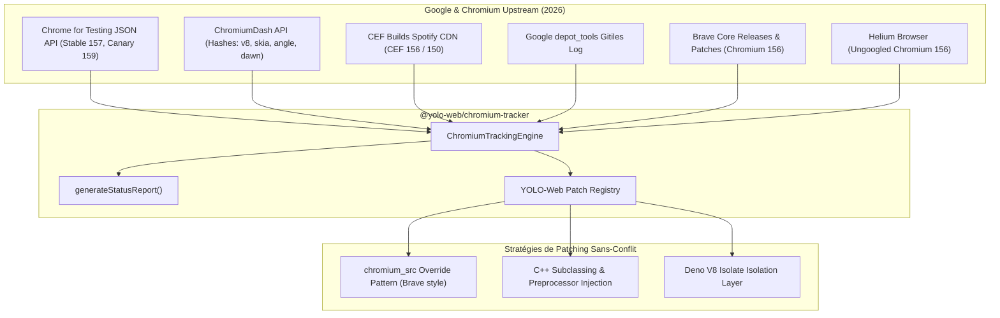

# YOLO-Web Chromium Automation & Tracking Architecture

Ce document détaille l'architecture d'automatisation, de tracking en temps réel et de gestion des patchs Chromium pour YOLO-Web en 2026.

---

## 1. Vue d'Ensemble & Stratégie 2026

YOLO-Web n'est pas un simple scraper ou un Chromium headless naïf. C'est un navigateur complet conforme aux standards de l'écosystème Chromium 157+ qui associe :

- **Host Plane** : Bun 1.4.4+ natif en Rust pur + WebKit/JSC pour l'outillage et l'automatisation.
- **Guest Browser Plane** : V8 Isolate (`deno_core` / `rusty_v8`) pour l'exécution JavaScript en page.
- **Rendu & CSS** : Moteur Servo Stylo CSS3 (`crates/servo-*`) & pipeline Obscura CDP.
- **Protection & Anti-Fingerprinting** : Brave Shields (`adblock-rust`, `cookiecrumbler`, `crates/brave-*`).
- **Tracking Amont en Temps Réel** : Suivi des canaux Chromium (Stable, Beta, Dev, Canary), CEF, Brave, Helium et Google `depot_tools`.



---

## 2. Dépôts & Outils Intégrés

| Composant                              | Rôle Amont                                    | Mécanisme d'Intégration YOLO-Web                                                                 |
| :------------------------------------- | :-------------------------------------------- | :----------------------------------------------------------------------------------------------- |
| **Google Chromium**                    | Moteur de référence Web & V8                  | Suivi continu via Chrome for Testing & ChromiumDash (`milestone 157..159`)                       |
| **Google depot_tools**                 | Outils de build (`gclient`, `fetch`, `ninja`) | Suivi Gitiles API sur `chromium.googlesource.com/chromium/tools/depot_tools`                     |
| **CEF (Chromium Embedded Framework)**  | Embedder C++ / C API Chromium                 | Index Spotify CDN (`windows64`, `linux64`, `macosarm64`) & crates `cef-rs` (`tauri-apps/cef-rs`) |
| **Brave Browser (`brave-core`)**       | Navigateur Chromium privé                     | Reprise des techniques `chromium_src` overrides, adblock-rust, farbling                          |
| **Helium Browser (`imputnet/helium`)** | Fork Chromium allégé (Ungoogled)              | Tracking des drapeaux de compilation légitimes et suppression de télémétrie                      |

---

## 3. Stratégie de Patching sans Conflit (`chromium_src` & Subclasses)

Pour éviter l'"enfer des rebases" lors des mises à jour rapides de Chromium (toutes les 4 semaines) :

1. **Dossier `chromium_src` Overrides** : Priorité accordée à nos fichiers d'en-tête et sources personnalisés avant la compilation Chromium amont.
2. **Subclassing C++** : Injection de hooks par sous-classement plutôt que réécriture directe du code source amont.
3. **Isolation V8 Isolate** : Encapsulation totale dans `crates/obscura-js` évitant toute fuite d'environnements hôtes ou variables d'environnement.

---

## 4. Commandes CLI Unifiées

```bash
# Vérifier l'état en direct d'upstream Chromium, CEF, Brave, Helium et depot_tools
web chromium status

# Auditer les patchs appliqués dans YOLO-Web
web chromium patches

# Lister les canaux officiels de Chrome (Stable, Beta, Dev, Canary)
web chromium channels

# Vérifier les dernières binaires CEF
web chromium cef

# Inspecter le dernier commit de Google depot_tools
web chromium depot-tools
```
