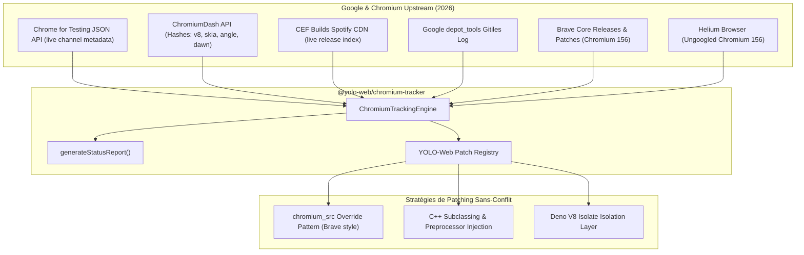

# YOLO-Web Chromium Automation & Tracking Architecture

Ce document détaille l'architecture d'automatisation, de tracking en temps réel et de gestion des patchs Chromium pour YOLO-Web en 2026.

---

## 1. Vue d'Ensemble & Stratégie 2026

YOLO-Web is a Rust + Bun browser tooling monorepo that currently combines Servo-derived components, Obscura, Brave libraries, and V8 integrations. It does **not** currently vendor or build Chromium/Blink; Chromium releases and `depot_tools` are tracked as upstream references. A Chromium-class engine requires a separate Chromium checkout and build, or a substantial standards and platform implementation effort.

- **Host Plane** : Bun for tooling and automation.
- **Guest Browser Plane** : V8 Isolate (`deno_core` / `rusty_v8`) pour l'exécution JavaScript en page.
- **Rendu & CSS** : Servo-derived Stylo and Obscura rendering components; these are not Blink.
- **Protection & Anti-Fingerprinting** : Brave Shields (`adblock-rust`, `cookiecrumbler`, `crates/brave-*`).
- **Tracking Amont en Temps Réel** : Suivi des canaux Chromium (Stable, Beta, Dev, Canary), CEF, Brave, Helium et Google `depot_tools`.



---

## 2. Dépôts & Outils Intégrés

| Composant                              | Rôle Amont                                    | Mécanisme d'Intégration YOLO-Web                                                                 |
| :------------------------------------- | :-------------------------------------------- | :----------------------------------------------------------------------------------------------- |
| **Google Chromium**                    | Moteur de référence Web & V8                  | Suivi live via Chrome for Testing & ChromiumDash; les versions et révisions sont lues depuis les API amont, jamais codées en dur. |
| **Google depot_tools**                 | Outils de build (`gclient`, `fetch`, `ninja`) | Suivi Gitiles API sur `chromium.googlesource.com/chromium/tools/depot_tools`                     |
| **CEF (Chromium Embedded Framework)**  | Embedder C++ / C API Chromium                 | Live Spotify CDN index (`windows64`, `linux64`, `macosarm64`) |
| **Brave Browser (`brave-core`)**       | Navigateur Chromium privé                     | Reprise des techniques `chromium_src` overrides, adblock-rust, farbling                          |
| **Helium Browser (`imputnet/helium`)** | Fork Chromium allégé (Ungoogled)              | Tracking des drapeaux de compilation légitimes et suppression de télémétrie                      |

---

## 3. Stratégie de Patching sans Conflit (`chromium_src` & Subclasses)

Pour éviter l'"enfer des rebases" lors des mises à jour rapides de Chromium (toutes les 4 semaines) :

1. **Dossier `chromium_src` Overrides** : Priorité accordée à nos fichiers d'en-tête et sources personnalisés avant la compilation Chromium amont.
2. **Subclassing C++** : Injection de hooks par sous-classement plutôt que réécriture directe du code source amont.
3. **Isolation V8 Isolate** : Encapsulation totale dans `crates/obscura-js` évitant toute fuite d'environnements hôtes ou variables d'environnement.

---

## 4. Commandes CLI Unifiées

## 4.1 Building Chromium itself

This repository has no `.gclient`, Chromium `DEPS`, Blink `BUILD.gn`, or Chromium source checkout. The commands below are the upstream workflow reference, not commands that build this Cargo + Bun monorepo. Keep a Chromium checkout in a separate directory and use the matching upstream branch/revision:

```sh
fetch --no-history chromium
cd src
gclient runhooks
gn gen out/Default
autoninja -C out/Default chrome
```

Chromium dependencies are pinned through `DEPS` and managed by `gclient`; do not copy component source snapshots into `crates/` without provenance, license, security review, and a defined update owner. For vendored Chromium dependencies, upstream expects a dedicated `third_party/<name>/` directory with `README.chromium`, `OWNERS`, and source under `src/`. See the official [build instructions](https://chromium.googlesource.com/chromium/src/+/main/docs/linux/build_instructions.md), [dependency management](https://chromium.googlesource.com/chromium/src/+/main/docs/dependencies.md), and [third-party guidance](https://chromium.googlesource.com/chromium/src/+/main/docs/adding_to_third_party.md).

```bash
# Vérifier l'état en direct d'upstream Chromium, CEF, Brave, Helium et depot_tools
web chromium status

# Auditer les patchs appliqués dans YOLO-Web
web chromium patches

# Lister les canaux officiels de Chrome (Stable, Beta, Dev, Canary)
web chromium channels

# Vérifier les dernières binaires CEF
web chromium cef

# Inspecter le dernier commit de Google depot_tools
web chromium depot-tools
```
