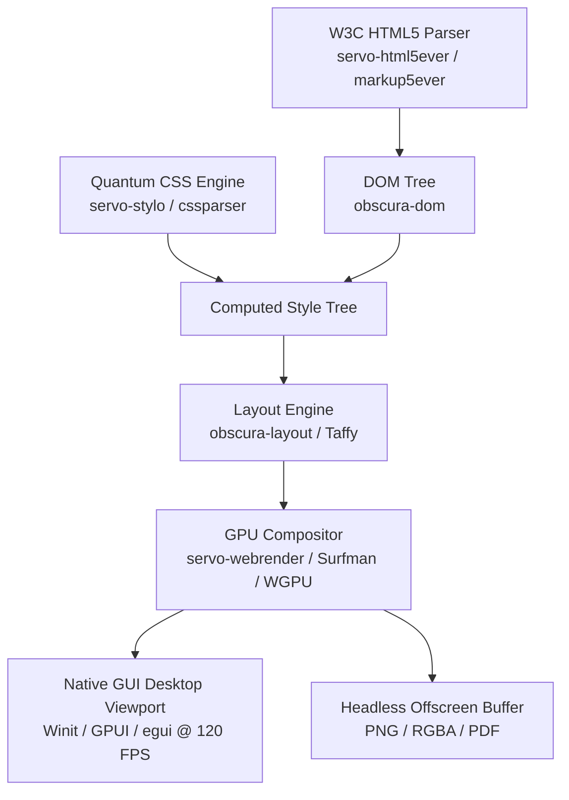

# Architecture Native GUI & Bare-Metal Rendering pour YOLO Monorepo

Ce document détaille l'intégration native complète de **Servo** (Stylo, Webrender, Euclid, Surfman), **Obscura** (DOM, V8 Deno Core, CDP) et de l'interface graphique native (GUI) éliminant tout recours à Electron.

---

## 1. Contexte et Objectifs

L'objectif architectural est de fournir un véritable navigateur de bureau complet :
- **Ultra-performant** : Rendu graphique matériel à 120 FPS sur GPU via WGPU / WebRender / Surfman.
- **Double mode** : Standalone Desktop Window (Winit + WGPU / GPUI / egui) ET Headless off-screen (screenshots PNG, bitmaps RGBA, PDF haute résolution).
- **Zéro Electron** : Suppression absolue d'Electron, de Node.js et des wrappers Chromium lourds.
- **Pureté Rust 2024 & Bun** : Tout le runtime hôte et les scripts tournent sous Bun ; le cœur du moteur est 100% Rust.

---

## 2. Pipeline Graphique & Composants

### Composants Clés

1. **DOM & HTML Parsing** :
   - [`crates/servo-html5ever`](file:///C:/src/yolo-web/crates/servo-html5ever) & [`crates/servo-markup5ever`](file:///C:/src/yolo-web/crates/servo-markup5ever)
   - Connecté directement à [`crates/obscura-dom`](file:///C:/src/yolo-web/crates/obscura-dom) pour la manipulation d'arbre conforme W3C.

2. **Style & Sélecteurs (Quantum CSS / Stylo)** :
   - [`crates/servo-stylo`](file:///C:/src/yolo-web/crates/servo-stylo) et [`crates/servo-cssparser`](file:///C:/src/yolo-web/crates/servo-cssparser)
   - Filtres de Bloom rapides et calcul de spécificité CSS3/CSS4.

3. **Géométrie & Algèbre Linéaire** :
   - [`crates/servo-euclid`](file:///C:/src/yolo-web/crates/servo-euclid) avec unités typées `CssPixel` et `DevicePixel`.

4. **Gestion de Surface & Compositing GPU** :
   - [`crates/servo-surfman`](file:///C:/src/yolo-web/crates/servo-surfman) : Gestion de surfaces matérielles multiplateformes (ANGLE, Direct3D12, Metal, EGL).
   - [`crates/servo-webrender`](file:///C:/src/yolo-web/crates/servo-webrender) : Display lists GPU accélérées.

5. **Passerelle GUI Native** :
   - [`crates/yolo-browser/src/gui.rs`](file:///C:/src/yolo-web/crates/yolo-browser/src/gui.rs) : Gestionnaire d'état de l'application de navigation (onglets, barre de navigation, omnibox, boucliers Brave Shields, dispatch d'événements souris et clavier).
   - [`crates/yolo-browser/src/compositor.rs`](file:///C:/src/yolo-web/crates/yolo-browser/src/compositor.rs) : Pipeline de composition d'images à 120 FPS pour la présentation fenêtre et l'export headless.

---

## 3. Points d'Entrée et Fichiers Clés

- **Façade Unifiée du Navigateur** :
  - [`crates/yolo-browser/src/lib.rs`](file:///C:/src/yolo-web/crates/yolo-browser/src/lib.rs)
- **Sous-système GUI & Interaction** :
  - [`crates/yolo-browser/src/gui.rs`](file:///C:/src/yolo-web/crates/yolo-browser/src/gui.rs)
- **Compositeur & Export Haute Fréquence** :
  - [`crates/yolo-browser/src/compositor.rs`](file:///C:/src/yolo-web/crates/yolo-browser/src/compositor.rs)
- **Implémentation Servoshell / Winit Desktop** :
  - [`crates/servo-engine/ports/servoshell/desktop/gui.rs`](file:///C:/src/yolo-web/crates/servo-engine/ports/servoshell/desktop/gui.rs)
  - [`crates/servo-engine/ports/servoshell/desktop/headed_window.rs`](file:///C:/src/yolo-web/crates/servo-engine/ports/servoshell/desktop/headed_window.rs)
- **Rendu Obscura & Screenshots** :
  - [`crates/obscura-render/src/paint.rs`](file:///C:/src/yolo-web/crates/obscura-render/src/paint.rs)
- **Client CDP & Pilotage IA Agent** :
  - [`crates/agent-browser/src/native/browser.rs`](file:///C:/src/yolo-web/crates/agent-browser/src/native/browser.rs)

---

## 4. Spécifications Techniques

- **Fréquence de Rafraîchissement** : V-Sync synchrone jusqu'à 120 FPS pour animations fluides et scrolling matériel.
- **Isolation Mémoire & Sécurité** : Filtrage SSRF via `obscura-ssrf`, blocage des traceurs via `brave-adblock`, sandboxing OS via `servo-gaol`.
- **Mode Headless Supérieur à Playwright** : Accès direct au frame buffer mémoire sans émulation de processus externe lourd, contrôle déterministe du temps d'animation Web Animations (`AnimationSampleTime`).
